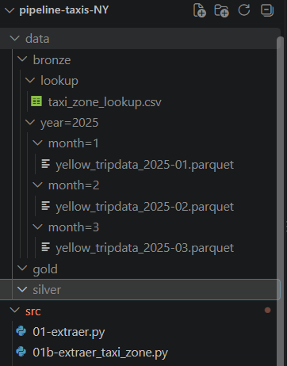
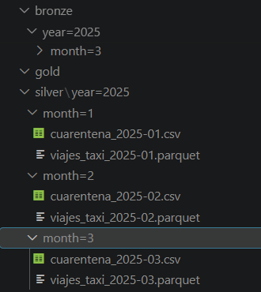

# pipeline-taxis-NY
Proyecto personal de estudio, usando datos de Taxis amarillos de New York.

## .gitignore
Se define que ni datos ni archivos duckdb se versionan.

## Proceso de extraccion Data Taxi Amarillo a Bronze
En este proceso se extrae la data desde el origen, y se almacena en sus respectivas capetas usando Particionamiento HIVE.

** Ejecución **
- `python src/01-extraer.py 2025 1` \
   Resutado: el archivo del periodo 202501 tiene 3475226 lineas.
- `python src/01-extraer.py 2025 2` \
   Resultado: el archivo del periodo 202502 tiene 3577543 lineas.
- `python src/01-extraer.py 2025 3` \
   Resultado: el archivo del periodo 202503 tiene 4145257 lineas.

## Proceso de extraccion de Datos de Taxi_Zone.
Se extraen los datos de la tabla lookup de Taxi_zone que viene en csv, y se almacena en la carpeta lookup dentro de Data.

** Ejecución **
- `python src/01b-extraer_taxi_zone.py` \
   Respuesta: el archivo lookup de Taxi_Zone tiene 265 lineas

### Imagenes Datos en Bronze

## Proceso de Validación de los datos en archivos Bronze
Proceso que realiza la validacion y limpieza de los datos del archivo en bronze.

Solicitud recibida de validacion de registros:

| Código | Regla de rechazo                          |
|:------:|:------------------------------------------|
| V01    | La fecha de inicio no corresponde al mes del archivo |
| V02    | La fecha de fin es anterior o igual a la de inicio |
| V03    | El viaje dura más de 24 horas |
| V04    | Distancia menor o igual a cero |
| V05    | Tarifa (fare_amount) o total (total_amount)negativos |
| V06    | Zona de origen o destino que no existe en la tablade zonas |
| V07    | Forma de pago fuera de los códigos del diccionario |
| V08    | Pasajeros igual a cero |
| V09    | Registro duplicado exacto: se acepta uno, el resto se rechaza |

** Ejecución del proceso **
- `python src/02-validar-origen.py 2025 1` \
   Resultado: 
   - El Archivo origen yellow_tripdata_2025-01.parquet tiene 3475226 registros, Registros Ok: 3229420, Registros Rechazados: 245806.

   Detalle cod_rechazo: \

| cod_rechazo | cant_registros |
|:-----------:|---------------:|
| V01         |             22 |
| V02         |           2051 |
| V03         |             20 |
| V04         |          90196 |
| V05         |         129866 |
| V08         |          23651 |

- `python src/02-validar-origen.py 2025 2`
   Resultado:
   - El Archivo origen yellow_tripdata_2025-02.parquet tiene 3577543 registros, Registros Ok: 3285841, Registros Rechazados: 291702.

   Detalle por cod_rechazo: \

│ cod_rechazo │ cant_registros │
|:-----------:|---------------:|
│ V01         │             31 │
│ V02         │           5164 │
│ V03         │             16 │
│ V04         │          99098 │
│ V05         │         166367 │
│ V08         │          21026 │

- `python src/02-validar-origen.py 2025 3`
   Resultado:
   - El Archivo origen yellow_tripdata_2025-03.parquet tiene 4145257 registros, Registros Ok: 3806372, Registros Rechazados: 338885.

   Detalle por cod_rechazo: \

│ cod_rechazo │ cant_registros │
|:-----------:|---------------:|
│ V01         │             33 │
│ V02         │          22280 │
│ V03         │             11 │
│ V04         │         102960 │
│ V05         │         192208 │
│ V08         │          21393 │

## Imagenes de Validación a Silver

#### Por el momento estos son los modulos que se requieren instalar
#### Claude esto no considerarlo por ahora
- `pip install requests`
- `pip install pandas pyarow`
- `pip install duckdb`