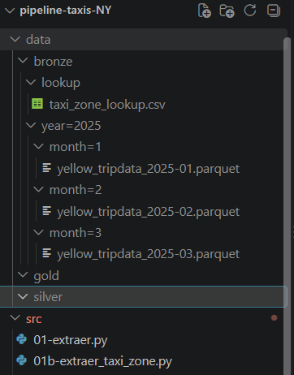

# pipeline-taxis-NY
Proyecto personal de estudio, usando datos de Taxis amarillos de New York.

## .gitignore
Se define que ni datos ni archivos duckdb se versionan.

## Proceso de extraccion Data Taxi Amarillo a Silver
En este proceso se extrae la data desde el origen, y se almacena en sus respectivas capetas usando Particionamiento HIVE.

** Ejecución **
- `pyton src/01-extraer.py 2025 1` \
   Resutado: el archivo del periodo 202501 tiene 3475226 lineas
- `pyton src/01-extraer.py 2025 2` \
   Resultado: el archivo del periodo 202502 tiene 3577543 lineas
- `pyton src/01-extraer.py 2025 3` \
   Resultado: el archivo del periodo 202503 tiene 4145257 lineas

## Proceso de extraccion de Datos de Taxi_Zone.
Se extraen los datos de la tabla lookup de Taxi_zone que viene en csv, y se almacena en la carpeta lookup dentro de Data.

** Ejecución **
- `python 01b-extraer_taxi_zone.py` \
   Respuesta: el archivo lookup de Taxi_Zone tiene 265 lineas

### Imagenes Datos en Silver

#### Por el momento estos son los modulos que se requieren instalar
- `pip install requests`
- `pip install pandas pyarow`